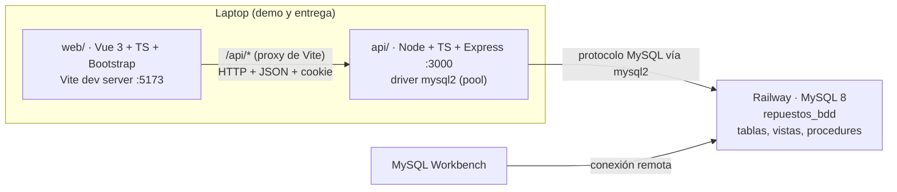

# Plan del frontend y del API (mysql2)

22 nov 2026 · detalla la sección *Stack y arquitectura* de [docs/planificacion.md](../docs/planificacion.md).

Alcance funcional: los casos de uso CU-01 a CU-13 de [planificacion.md › Casos de uso](../docs/planificacion.md#casos-de-uso). Este plan dice **cómo** se construyen; los casos de uso dicen **qué**.

## 1. Decisiones tomadas

| Tema | Decisión | Por qué |
| --- | --- | --- |
| Base de datos | MySQL en **Railway** (schema `repuestos_bdd`) | MySQL real con `root`: el `.sql` corre igual que en local, sin líos de `DEFINER` ni `SUPER`. La prueba de $5 por 30 días cubre la entrega; si el crédito se acaba, Hobby cuesta $5/mes |
| Driver | **`mysql2`** (Node) | Cumple el requisito del PF ("usar un driver de conexión a MySQL"). No está en la presentación (S14TP01), pero se defiende por analogía con JDBC (ver 4.1). Pendiente: confirmar con el profe que lo acepta |
| API | **Node LTS + TypeScript + Express** | Un solo lenguaje en el front y en el API, y lo único que hay que instalar es Node |
| Front | **Vue 3 + TypeScript** (create-vue), skill `vue-ts` | Ya decidido |
| Estilos | **Bootstrap 5** con Sass, sin BootstrapVue | El foco del proyecto es la base de datos; Bootstrap resuelve la UI rápido |
| Sesión | `express-session` (cookie) + **`bcryptjs`** | Cerrar sesión es destruir la sesión. `bcryptjs` es bcrypt en JS puro: no compila nada nativo en Windows y genera el mismo hash de 60 caracteres que espera `hash_contrasena CHAR(60)` |
| Validación de entrada | `zod` en el API | Revisa la forma del JSON de cada request antes de que llegue a la base |
| Gráficos | Chart.js + `vue-chartjs` | Dashboard (CU-03) |
| PDF | `jsPDF` + `jspdf-autotable`, en el navegador | Reportes (CU-05) |
| Hosting | Local para la entrega y la demo. Hostear (front en Vercel, API en Railway) es un extra opcional al final | La entrega pide un README.txt para correrlo en local |

## 2. Sistema de diseño (se hace en otra sesión)

La identidad visual vive en `design/` y es la fuente de verdad para todo lo visual del front:

```text
design/
├── DESIGN.md                  tokens (colores, tipografía, espaciado, radios, sombras) y reglas de uso
├── brand-board.*              logo, paleta y tipografías de Carlitos
└── dashboard-ui-reference.*   referencia de layout: sidebar, KPIs, gráficos, tablas
```

Cómo se conecta con el front:

- **Un solo punto de cambio:** `web/src/assets/styles/_tokens.scss` traduce los tokens de `DESIGN.md` a variables de Sass de Bootstrap (`$primary`, `$font-family-base`, `$border-radius`, …). Después de ese archivo se importa `bootstrap/scss/bootstrap`.
- **Se usa Sass y no solo variables CSS:** en Bootstrap 5.3, cambiar `--bs-primary` en `:root` no recolorea `.btn-primary`, porque los componentes toman el valor que se compiló desde Sass.
- **Layout:** `AppSidebar`, `AppTopbar`, `KpiCard` y `ChartCard` siguen `dashboard-ui-reference`.
- **Mientras `design/` no exista:** se trabaja con Bootstrap por defecto y `_tokens.scss` queda vacío. Ningún componente lleva colores ni tamaños sueltos, así que aplicar el diseño después es cambiar un solo archivo.

## 3. Arquitectura



El navegador no puede conectarse directo a MySQL de forma segura (las credenciales quedarían en el bundle), así que el driver vive en el API.

### Estructura del repo

```text
carlitos-co-admin/
├── database/        schema.sql, views.sql, procedures.sql (ya existen)
├── design/          sistema de diseño (otra sesión)
├── docs/            planificacion.md, investigar_bdd.md
├── api/             Node + TS + Express + mysql2
├── web/             Vue
└── README.txt       cómo correr todo sin errores (lo pide la entrega)
```

## 4. API (`api/`)

Arquitectura hexagonal: el dominio no sabe que existe `mysql2`, y todo el código del driver vive en `infrastructure/mysql/`.

```text
api/
├── package.json                  express, mysql2, express-session, bcryptjs, zod
│                                 dev: typescript, tsx, @types/express, @types/express-session
├── tsconfig.json                 strict, sin any implícito
├── .env.example                  DB_HOST, DB_PORT, DB_USER, DB_PASSWORD, DB_NAME, PORT, SESSION_SECRET
└── src/
    ├── main.ts                   composition root: crea el pool, los repositorios, los casos de uso y la app
    ├── config/env.ts             lee y valida process.env al arrancar (falla claro si falta algo)
    ├── domain/
    │   ├── models/               tipos: Cliente, Repuesto, Pago, Empleado, Sesion, filas de cada vista
    │   ├── ports/                interfaces: ClienteRepository, RepuestoRepository, PagoRepository,
    │   │                         EmpleadoRepository, ReporteRepository, CatalogoRepository
    │   ├── ResultadoProcedure.ts éxito o fallo + mensaje (ver 4.2)
    │   └── errors.ts             ReglaNegocioError, NoAutorizadoError
    ├── application/              casos de uso: IniciarSesion, ContratarEmpleado, RegistrarPago, …
    └── infrastructure/
        ├── mysql/
        │   ├── pool.ts           mysql.createPool({ host, port, user, password, database })
        │   ├── llamarProcedure.ts    execute('CALL ...') + lectura de la columna `mensaje`
        │   └── Mysql*Repository.ts   una clase por port
        └── http/
            ├── app.ts            express() + json + session + rutas + errorHandler
            ├── routes/           un archivo por módulo (*.routes.ts), con los esquemas zod de su body
            └── middleware/       requireAuth.ts, requireRol.ts, errorHandler.ts
```

Scripts: `dev` (`tsx watch --env-file=.env src/main.ts`), `build` (`tsc`), `start` (`node --env-file=.env dist/main.js`), `type-check` (`tsc --noEmit`). El `--env-file` de Node lee el `.env` sin instalar `dotenv`.

### 4.1 Analogía con JDBC (para la defensa)

El profe enseñó JDBC (S14TP01, diap. 9). `mysql2` sigue el mismo flujo, con otros nombres:

| JDBC (diap. 9) | `mysql2` | Dónde está en el proyecto |
| --- | --- | --- |
| `DriverManager` + `Connection` | `mysql.createPool()` + `pool.getConnection()` | `infrastructure/mysql/pool.ts` |
| `PreparedStatement` | `execute(sql, params)` con `?`: prepared statements reales del servidor | Todos los `SELECT` |
| `CallableStatement` | `execute('CALL registrar_pago(?, ?, ?, ?, ?)', params)` | `llamarProcedure.ts` |
| `ResultSet` / `ResultSetMetaData` | `[filas, campos]` que devuelve `execute` | Repositorios |
| `setAutoCommit(false)` / `commit()` / `rollback()` | `beginTransaction()` / `commit()` / `rollback()` | Emitir factura (ver 7) |
| `close()` | `conn.release()` (vuelve al pool) / `pool.end()` | `finally` de cada transacción |
| Tipo de driver | Equivale al **Tipo 4**: JS puro que habla directo el protocolo de red de MySQL | — |

Lo mismo en código:

```ts
// Vistas y SELECT: prepared statement con "?" (evita inyección SQL)
const [filas] = await pool.execute<RowDataPacket[]>('SELECT * FROM Cuentas_por_cobrar')

// Procedures: CALL con parámetros. Un CALL devuelve varios result sets;
// el primero trae la fila con la columna `mensaje`
const [resultados] = await pool.execute<RowDataPacket[][]>(
  'CALL registrar_pago(?, ?, ?, ?, ?)',
  [codigoPago, numeroFactura, monto, formaPago, referencia],
)
const mensaje = resultados[0]?.[0]?.['mensaje']
```

**Pool:** en vez de abrir una `Connection` por pedido (lo que hace la diapositiva con `DriverManager`), el pool mantiene unas pocas conexiones abiertas y las presta. Contra una base en la nube, abrir conexión en cada pedido agrega latencia visible.

### 4.2 Errores de los procedures

Hoy los procedures no usan `SIGNAL`: responden un `SELECT ... AS mensaje` que empieza con `COMMIT:` o `ROLLBACK:`. `llamarProcedure.ts` lee ese texto:

- `COMMIT: …` → 200 `{ "mensaje": "..." }`
- `ROLLBACK: …` → lanza `ReglaNegocioError` → 422 `{ "mensaje": "..." }`. El front muestra el texto tal cual ("el pago de 50 supera el saldo pendiente de 20").
- Error del driver (conexión, SQL inválido) → 500 con un mensaje genérico, y el detalle va al log del API.

Si después se pasan los procedures a `SIGNAL SQLSTATE '45000'` (la pista pendiente de [investigar_bdd.md](../docs/investigar_bdd.md)), solo cambia `llamarProcedure.ts`: un error de `mysql2` con `sqlState === '45000'` → 422 con su `message`.

### 4.3 Endpoints

| Método y ruta | CU | Qué llama |
| --- | --- | --- |
| `POST /api/auth/login` | CU-01 | `SELECT` de `tEmpleado` + `tRol` por `usuario`, luego `bcrypt.compare`; rechaza si `activo = 0` |
| `POST /api/auth/logout` | CU-02 | `req.session.destroy()` |
| `GET /api/auth/me` | — | Empleado y rol de la sesión (el front lo usa al recargar) |
| `GET /api/reportes/repuestos-disponibles` | CU-03, CU-04 | Vista `repuestos_disponibles` |
| `GET /api/reportes/cuentas-por-cobrar` | CU-03, CU-04 | Vista `Cuentas_por_cobrar` |
| `GET /api/reportes/empleados` | CU-04 | Vista `Empleados` |
| `GET /api/reportes/bodegas` | CU-03, CU-04 | Vista `Bodegas_Disponibles` |
| `GET /api/reportes/desempeno-marca` | CU-03, CU-04 | Vista `Desempeno_marca` |
| `GET /api/catalogos/:nombre` | — | Para los `<select>`: marcas, categorias, bodegas, ciudades, tipos-identificacion, formas-pago, roles. Lista blanca de nombres: nunca se arma SQL con el parámetro |
| `GET /api/clientes` · `POST /api/clientes` | CU-06 | `SELECT` de `tCliente` · `registrar_cliente` |
| `GET /api/repuestos` · `POST /api/repuestos` | CU-07 | `SELECT` de `tProducto` · `ingresar_repuesto` |
| `POST /api/repuestos/traslados` | CU-08 | `trasladar_repuesto` |
| `POST /api/facturas` | CU-09 ⚠ | Pendiente (ver 7) |
| `GET /api/pagos?factura=` · `POST /api/pagos` | CU-10 | `SELECT` de `tPago` · `registrar_pago` |
| `DELETE /api/pagos/:codigo` | CU-11 | `eliminar_pago` |
| `POST /api/empleados` | CU-12 | El API genera el hash con `bcrypt.hash` y llama a `contratar_empleado` (que recibe `p_hash_contrasena CHAR(60)`) |
| `PATCH /api/empleados/:codigo/baja` | CU-13 ⚠ | Pendiente (ver 7) |

La contraseña nunca llega a la base en texto plano: se hashea en el API. En la defensa hay que decir *hash*, no *cifrado*.

`express-session` guarda las sesiones en memoria por defecto: al reiniciar el API todos tienen que volver a entrar. Para la demo está bien.

## 5. Front (`web/`)

Convenciones del skill `vue-ts`. Paths, textos de UI e identificadores de dominio en español.

```text
web/
├── .env.example                 VITE_API_URL=/api
├── vite.config.ts               alias @/ y proxy /api → http://localhost:3000
└── src/
    ├── main.ts                  importa styles/main.scss y el JS de Bootstrap
    ├── App.vue                  layout con sidebar si hay sesión, solo <RouterView> en /login
    ├── assets/styles/
    │   ├── _tokens.scss         tokens de design/DESIGN.md → variables de Bootstrap
    │   └── main.scss            _tokens + bootstrap/scss/bootstrap + estilos propios
    ├── config/env.ts            único lugar que lee import.meta.env
    ├── router/index.ts          rutas + guard de sesión y de rol
    ├── types/                   cliente.ts, repuesto.ts, pago.ts, empleado.ts, reportes.ts, api.ts
    ├── services/
    │   ├── http.ts              fetch + response.ok + errores tipados (ver 5.3)
    │   └── authService.ts, clientesService.ts, repuestosService.ts, pagosService.ts,
    │       empleadosService.ts, reportesService.ts, catalogosService.ts
    ├── stores/                  auth, clientes, repuestos, pagos, empleados, reportes, catalogos, notificaciones
    ├── utils/                   moneda.ts, fecha.ts, exportarPdf.ts
    ├── components/
    │   ├── layout/              AppSidebar, AppTopbar
    │   ├── common/              DataTable, ConfirmDialog, FormField, KpiCard, ChartCard, ToastHost, EmptyState
    │   ├── clientes/            ClienteForm
    │   ├── repuestos/           RepuestoForm, TrasladoForm
    │   ├── pagos/               PagoForm, PagosTable
    │   ├── empleados/           EmpleadoForm
    │   └── reportes/            ReporteTable, BotonPdf
    └── views/                   una por ruta (5.1)
```

Los tipos de las respuestas están en `api/src/domain/models/` y en `web/src/types/`. Duplicarlos es a propósito: compartir una carpeta entre los dos proyectos complica el tooling, y son pocos tipos.

### 5.1 Rutas

| Path | `name` | View | CU | Rol |
| --- | --- | --- | --- | --- |
| `/login` | `login` | LoginView | CU-01 | pública |
| `/` | `dashboard` | DashboardView | CU-03 | empleado |
| `/clientes` | `clientes` | ClientesView | CU-06 | empleado |
| `/repuestos` | `repuestos` | RepuestosView (incluye traslados) | CU-07, CU-08 | empleado |
| `/facturas/nueva` | `factura-nueva` | FacturaNuevaView | CU-09 ⚠ | empleado |
| `/pagos` | `pagos` | PagosView | CU-10, CU-11 | empleado |
| `/administracion-empleados` | `administracion-empleados` | AdministracionEmpleadosView | CU-12, CU-13 | admin |
| `/reportes/:vista` | `reporte` | ReporteView (una sola, parametrizada por vista) | CU-04, CU-05 | empleado |
| `/:pathMatch(.*)*` | `no-encontrado` | NotFoundView | — | pública |

Todas las views con `component: () => import(...)`. El guard pide `GET /api/auth/me` una sola vez (carga compartida, plantilla 3.2 del skill). Sin sesión manda a `/login?redirect=...`, y sin rol, al dashboard. CU-02 es el botón de cerrar sesión de `AppTopbar`.

### 5.2 Componentes dirigidos por eventos (punto de la rúbrica)

Los datos bajan por props y las acciones suben como eventos tipados. Ningún componente de `common/` ni de dominio conoce stores ni rutas: la view escucha los eventos y llama al store.

| Componente | Props | Emits |
| --- | --- | --- |
| `DataTable<T>` | `columnas`, `filas`, `cargando`, `filtro` | `update:filtro`, `seleccionar: [fila: T]` |
| `ClienteForm` | `cliente?`, `catalogos`, `enviando` | `enviar: [datos: ClienteNuevo]`, `cancelar: []` |
| `RepuestoForm` / `TrasladoForm` | `catalogos`, `enviando` | `enviar: [...]`, `cancelar: []` |
| `PagoForm` | `factura`, `formasPago`, `enviando` | `enviar: [datos: PagoNuevo]` |
| `PagosTable` | `pagos` | `eliminar: [codigo: string]` |
| `ConfirmDialog` | `titulo`, `mensaje`, `abierto` | `confirmar: []`, `cancelar: []` |
| `ReporteTable` + `BotonPdf` | `columnas`, `filas`, `titulo` | `exportar: []` |
| `KpiCard` / `ChartCard` | `titulo`, `valor` / `datos` | — |

Ejemplo de flujo (CU-11): `PagosTable` emite `eliminar` → `PagosView` abre `ConfirmDialog` → `confirmar` → `pagosStore.eliminar(codigo)` → `DELETE /api/pagos/:codigo` → toast con el `mensaje` del procedure → recarga la lista.

### 5.3 Stores y services

- Un store por dominio, con sintaxis setup: datos, `isLoading`, `error`. Para los listados se usan las plantillas 3.1 y 3.2 del skill: cancelar antes de mirar la caché, y que solo la última petición apague el loading.
- Después de un `POST` o `DELETE` que sale bien, el store invalida la caché de `reportes`, porque las vistas cambian.
- `http.ts` lanza errores tipados que la UI distingue con `instanceof`:
  - `NoAutorizadoError` (401) → el store `auth` limpia la sesión y el router manda a `/login`.
  - `ReglaNegocioError` (422) → toast con el `mensaje` del procedure.
  - `ErrorServidor` (500 o red) → toast genérico.
- `catalogosStore` carga una vez cada catálogo y lo comparte entre formularios.

### 5.4 Dashboard y reportes

- **Dashboard (CU-03):** KPIs con saldo total por cobrar (`Cuentas_por_cobrar`), valor total en bodegas (`Bodegas_Disponibles`) y número de repuestos con stock (`repuestos_disponibles`). Gráficos de venta por marca y categoría (`Desempeno_marca`) y de valor por bodega (`Bodegas_Disponibles`).
- **Reportes (CU-04, CU-05):** una sola `ReporteView` que recibe `:vista`. Un mapa en `types/reportes.ts` define el título, las columnas y el formato (moneda o fecha) de cada vista. `exportarPdf.ts` usa `jspdf-autotable` con el título, la fecha de generación y el usuario de la sesión.

## 6. Orden de trabajo

Código congelado el **26 nov**. Lo que no llegue al 25 nov se recorta empezando por los ⚠.

- [ ] **22 nov · Preguntar al profe** si acepta `mysql2` como driver. Si dice que no, el plan B es JDBC (solo cambia `api/`; el front no se entera).
- [ ] **22 nov · Base en Railway:** crear el servicio MySQL, cargar `schema.sql`, `views.sql` y `procedures.sql`, y datos de prueba. Revisar la zona horaria (`eliminar_pago` usa `CURDATE()`).
- [ ] **22 nov · Prueba del driver:** `api/` con `package.json` y un `SELECT 1` con `mysql2` contra Railway.
- [ ] **23 nov · API base:** `env.ts`, `pool.ts`, `llamarProcedure.ts`, `errorHandler`, login y logout con `bcryptjs`, `requireAuth` y `requireRol`.
- [x] **23 nov · Front base:** scaffold de create-vue, Bootstrap + `_tokens.scss`, proxy, layout, router con guard, `http.ts`, store `auth`, LoginView.
- [ ] **24 nov · Reportes de punta a punta:** 5 endpoints de vistas, `ReporteView`, PDF y dashboard. *Front hecho con mocks (`ReporteView`, PDF y dashboard); faltan los 5 endpoints del API.*
- [ ] **24-25 nov · Modificadores:** clientes, repuestos y traslados, pagos (alta y baja), empleados. *Front hecho con mocks; faltan los endpoints del API.*
- [x] **25 nov · Diseño:** aplicar `design/` en `_tokens.scss` y en el layout, si ya existe.
- [ ] **25-26 nov · ⚠ Facturación y baja de empleado**, según lo que se decida en 7. *Front: la factura nueva está hecha con un body propuesto (`web/src/types/factura.ts`); la baja de empleado es un botón deshabilitado con el tooltip "Pendiente". Falta el API de las dos.*
- [ ] **26 nov · Cierre:** README.txt, `.env.example` de los dos proyectos, prueba en una máquina limpia, y `npm run type-check` + `npm run lint` + `npm run build` en `api/` y `web/`.

## 7. Pendientes y riesgos

- **CU-09 Emitir factura no tiene procedure.** Opciones:
  - Crear `emitir_factura` en SQL. Sigue la regla del proyecto de "procedure para flujos que inicia el usuario", pero pasar el detalle (varias líneas) a un procedure es incómodo en MySQL.
  - Hacer la transacción desde el API con `mysql2`:

    ```ts
    const conn = await pool.getConnection()
    try {
      await conn.beginTransaction()
      await conn.execute('INSERT INTO tFactura (...) VALUES (?, ...)', [/* cabecera */])
      for (const linea of lineas) {
        await conn.execute('INSERT INTO tDetalleFactura (...) VALUES (?, ...)', [/* línea */])
      }
      await conn.commit()
    } catch (error) {
      await conn.rollback() // todo o nada: si falla una línea, no queda la cabecera sola
      throw error
    } finally {
      conn.release()
    }
    ```

  Recomendación: la transacción desde el API. Muestra el driver haciendo una transacción ACID en la demo y se explica con la misma analogía de 4.1. Hay que decidirlo antes del 24 nov.

  El front ya está hecho con el body propuesto en `web/src/types/factura.ts`. Las 4 decisiones que hay que cerrar con el API (forma de pago, número de factura, IVA y stock) están en *Decisiones pendientes* de [planificacion.md](planificacion.md).
- **CU-13 Dar de baja empleado:** un `UPDATE tEmpleado SET activo = 0 WHERE codigo_empleado = ?` con `execute`, o un procedure chico. Es baja prioridad. **Nunca un `DELETE`:** los empleados solo se desactivan (las facturas y compras los referencian, y `contratar_empleado` los reactiva con la misma cédula).
- **Roles:** ¿qué valores tiene `tRol`? Hace falta saber cuál código es el de administrador para `requireRol` y el guard. Sale de los datos de prueba o de Carlitos.
- **Usuario MySQL de la app:** el API no debería entrar como `root`. Crear un usuario con `GRANT SELECT` sobre tablas y vistas, `GRANT EXECUTE` sobre los procedures y `INSERT` sobre las tablas de factura si se hace la transacción desde el API (ver [investigar_bdd.md](../docs/investigar_bdd.md)).
- **Credenciales:** `api/.env` fuera del repo (falta crear `.gitignore` con `.env` y `node_modules/`). En `web/` no va ningún secreto: lo que lleva `VITE_*` termina en el bundle.
- **Plan B de la demo:** MySQL local con los mismos `.sql`. Cambiar de base es cambiar las variables `DB_*`.
- **Registro de conceptos nuevos** (planificación, regla 2): Express y `mysql2` ya están. Faltan `express-session`, `bcryptjs` (reemplaza a `bcrypt` en la fila existente), `zod`, el proxy de Vite y Bootstrap con Sass. Los conceptos del front (Pinia, Vue Router, Chart.js y vue-chartjs, jsPDF y autotable, Bootstrap con Sass, Bootstrap Icons, el proxy de Vite, el patrón de mocks intercambiables y Vitest) ya están en *Registro de conceptos nuevos* de la planificación.
