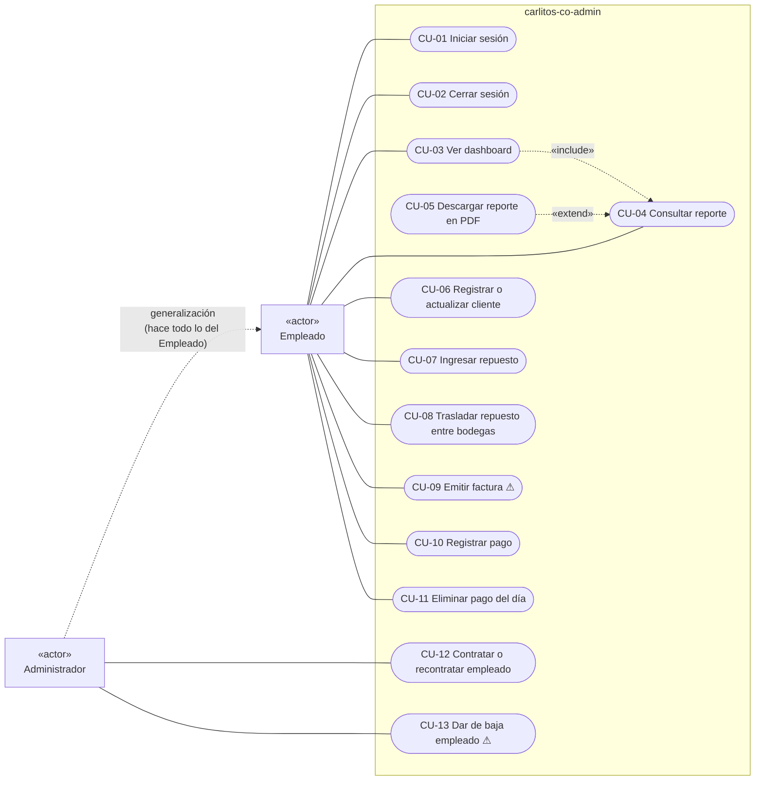
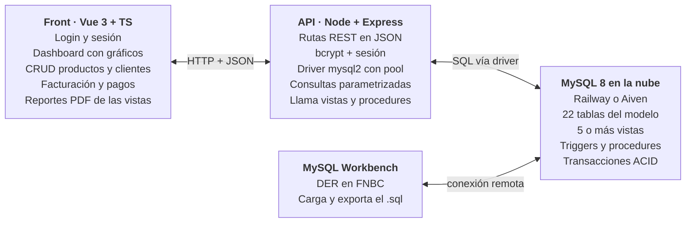

# carlitos-co-admin — Planificación del proyecto final (BDD)

16 nov 2026 · Emilio Puga

> Copia en Markdown del doc de planificación ([versión editable](https://claude.ai/artifact/63kSPxwzGmURCdyMpphiP4)), exportada el 22 nov 2026. Los diagramas del doc están aquí como Mermaid y como tabla.

## Resumen

carlitos-co-admin es un panel de administración web para la empresa de Carlitos. Muestra las ventas y el resto de datos del negocio de forma clara, bonita y detallada, y permite agregar y modificar productos y otros registros. Es el proyecto final de CMP 4002 Base de Datos y se entrega el 29 nov 2026.

| Dato | Valor |
| --- | --- |
| Repo | carlitos-co-admin |
| Equipo | Milo y Andrés |
| Cliente | Carlitos (contacto: Andrés) |
| Curso | CMP 4002 Base de Datos, prof. Noel Pérez |
| Front | Vue + TypeScript |
| Base de datos | MySQL en la nube (plataforma por decidir, ver Stack) |

## Qué evalúa el profesor

El proyecto vale el 20 % de la nota final y la rubrica premia tanto cumplir todo como poder defenderlo: completo pero mal defendido saca 50 %. Requisitos tomados del enunciado del Proyecto Final (202520_CMP0417-S13PF_c.pdf) y del syllabus.

### Back-end (MySQL)

- [x] Entre 8 y 10 tablas, sin contar las de relaciones N:M ni diccionarios, con una cantidad razonable de atributos por tabla
- [x] Mínimo 3 relaciones N:M (pueden ser diccionarios) y al menos 5 relaciones 1:N
- [x] Al menos 5 vistas
- [x] INSERT, UPDATE y DELETE sobre un esquema transaccional
- [x] DER en FNBC hecho en MySQL Workbench

### Front-end

- [ ] Usar un driver de conexión a MySQL
- [ ] Ejecutar todos los modificadores (INSERT, UPDATE, DELETE) desde el front
- [ ] Reportes sobre las 5 vistas, descargables en PDF
- [ ] Módulo de usuario: sign-in y sign-out con contraseña encriptada
- [ ] Creatividad y calidad, con componentes de alto nivel dirigidos por eventos
- [x] No se permite phpMyAdmin

### Entrega en D2L

- [ ] Informe: portada, Resumen, Introducción, Problema (estilo enunciado de clase o examen), Solución (DER, vistas, stored procedures, triggers, etc.) y Conclusiones
- [ ] Presentación en formato original (PPT, KEY)
- [ ] Front-end con README.txt que explique cómo correrlo sin errores
- [ ] Back-end con el DER y el .sql con toda la implementación

### Presentación en clase

- 15 minutos: 8 de exposición (problema y técnicas) y 7 de demo con voz en off, más 3 de preguntas.
- Ambos deben dominar el proyecto de inicio a fin, y deben asistir todos los días de presentaciones (faltar penaliza 50 %).

### IA generativa (obligatorio)

- [ ] Informar en qué partes se usó IA, con qué herramientas y qué prompts. Atribuirse soluciones de IA penaliza 50 % de la rúbrica. Por eso este doc lleva un registro de uso de IA (ver Decisiones pendientes).

## Reglas del proyecto

Usamos primero lo visto en clase. Lo nuevo se puede usar, pero se avisa, se investiga y se documenta antes de meterlo, porque los dos tenemos que poder defenderlo.

1. **Conceptos de clase primero.** Si algo se puede resolver con un tema del syllabus (vistas, triggers, procedures, transacciones, joins, restricciones), se resuelve así.
2. **Concepto nuevo = aviso + registro.** Antes de usarlo, quien lo propone avisa al otro y lo anota en *Registro de conceptos nuevos* con: qué es, por qué lo necesitamos, qué alternativa de clase había y la fuente.
3. **Pautas del profe por defecto.** Si conviene romper una, se anota en *Decisiones pendientes* la pauta, la excepción y la razón, para poder justificarla en la defensa.
4. **SQL siempre en MySQL**, con la sintaxis y el estilo de clase.
5. **Front:** Vue + TypeScript con el skill de frontend design. Nada de convenciones o código de la pasantía.
6. **Registro de IA:** cada vez que usemos IA, anotamos la parte, la herramienta y el prompt. Lo exige el enunciado.
7. **Los dos dominan todo.** Cada uno explica al otro lo que hizo antes de darlo por terminado.

## Alcance propuesto

El MVP son 7 módulos que cubren todos los requisitos del enunciado; compras, devoluciones, empleados y búsqueda por vehículo quedan como extras si sobra tiempo. Parte del modelo que ya está en el repo (`crear_tablas.sql`, 22 tablas de una empresa de repuestos).

| Módulo | Qué hace | Tablas | Requisito que cubre | Prioridad |
| --- | --- | --- | --- | --- |
| Login | Sign-in y sign-out de empleados con contraseña hasheada y rol | tEmpleado, tRol | Módulo de usuario | MVP |
| Dashboard de ventas | KPIs y gráficos sobre las vistas: ventas por mes, top productos, ventas por categoría y marca, saldo por cobrar | Vistas | Creatividad, reportes | MVP |
| Productos | Alta, edición y baja con categoría, marca, modelos compatibles y proveedores | tProducto, tCategoria, tMarca, tCompatibilidad, tProductoProveedor | INSERT, UPDATE, DELETE | MVP |
| Clientes | Alta, edición y baja | tCliente, tTipoIdentificacion, tCiudad | INSERT, UPDATE, DELETE | MVP |
| Facturación | Crear factura con su detalle en una transacción, descontar stock y registrar pagos | tFactura, tDetalleFactura, tPago, tFormaPago | Esquema transaccional | MVP |
| Inventario | Stock por bodega y alerta de productos bajo el mínimo | tInventario, tBodega | Vistas | MVP |
| Reportes PDF | Descargar cada vista en PDF | Vistas | Reportes PDF | MVP |
| Compras | Registrar compras a proveedores y sumar stock | tCompra, tDetalleCompra, tProveedor | Transacciones (refuerzo) | Extra |
| Devoluciones | Notas de crédito que devuelven stock | tNotaCredito, tDetalleNotaCredito | Triggers (refuerzo) | Extra |
| Empleados | Gestión de empleados y roles por el administrador | tEmpleado, tRol | INSERT, UPDATE, DELETE | Extra |
| Búsqueda por vehículo | Repuestos compatibles con un modelo de auto | tModelo, tCompatibilidad | Demo vistosa | Extra |

**Conteo del modelo actual contra el enunciado:** 10 tablas principales (Cliente, Empleado, Proveedor, Producto, Modelo, Bodega, Compra, Factura, Pago, NotaCredito), 6 diccionarios (TipoIdentificacion, Ciudad, Rol, Categoria, Marca, FormaPago) y 6 tablas N:M. Cumple el rango de 8 a 10 y las 3 N:M, pero queda en el límite: no agregar tablas principales sin quitar otra.

## Casos de uso

Sirve para confirmar qué tiene que hacer el sistema antes de programar el front. Está armado sobre lo que ya existe en `database/procedures.sql` y `database/views.sql`. Los casos marcados con ⚠ todavía no tienen procedure detrás. Los dos actores son provisionales hasta que Carlitos diga quién usa el panel (ver *Preguntas para Carlitos*).

| CU | Qué hace | Detrás en la base | Modificador |
| --- | --- | --- | --- |
| CU-01 | Valida usuario y contraseña (hash bcrypt) contra `tEmpleado` y abre sesión con el rol | `SELECT` sobre `tEmpleado` + `tRol` | — |
| CU-02 | Cierra la sesión | — | — |
| CU-03 | KPIs y gráficos armados con las vistas | Las 5 vistas | — |
| CU-04 | Tabla de cada vista con filtros | `repuestos_disponibles`, `Cuentas_por_cobrar`, `Empleados`, `Bodegas_Disponibles`, `Desempeno_marca` | — |
| CU-05 | Exporta la tabla de CU-04 a PDF | — | — |
| CU-06 | Alta de cliente; si ya existe, actualiza sus datos | `registrar_cliente` | INSERT / UPDATE |
| CU-07 | Crea el repuesto con su stock inicial, o suma stock si ya existe | `ingresar_repuesto` | INSERT / UPDATE |
| CU-08 | Mueve stock de una bodega a otra | `trasladar_repuesto` | UPDATE / INSERT / DELETE |
| CU-09 ⚠ | Cabecera + detalle de factura en una sola transacción | Sin procedure: decidir entre crear `emitir_factura` o una transacción JDBC desde el API | INSERT |
| CU-10 | Abono a una factura sin pasar el saldo | `registrar_pago` | INSERT |
| CU-11 | Borra un pago, solo si se registró hoy | `eliminar_pago` | DELETE |
| CU-12 | Alta de empleado, o reactivación si la cédula ya existía | `contratar_empleado` | INSERT / UPDATE |
| CU-13 ⚠ | Marca `activo = 0` | Sin procedure | UPDATE |

Con CU-06, CU-08 y CU-11 ya se cubren INSERT, UPDATE y DELETE desde el front. CU-09 es el único hueco grande: sin él no hay facturas nuevas que muestren las vistas de ventas.

## Preguntas para Carlitos

Sí hay que preguntarle: las 4 primeras pueden cambiar el DER, así que Andrés debería hacerlas primero, idealmente antes del 18 nov 2026. Si alguna ya se habló al hacer el modelo, se marca y se anota la respuesta debajo.

### Cambian el modelo (urgentes)

- [ ] ¿Cuántas bodegas tiene y de cuál sale el producto cuando vende? (hoy `tDetalleFactura` no guarda bodega)
- [ ] ¿Todos los productos llevan el mismo IVA? (hoy el IVA va por factura, no por producto)
- [ ] ¿Los clientes pagan una factura en partes (abonos) o de una sola vez? ¿Qué formas de pago acepta?
- [ ] ¿Las devoluciones pueden ser parciales? ¿Devuelve el dinero o deja saldo a favor?

### Definen el dashboard y los reportes

- [ ] ¿Qué 3 preguntas se hace sobre su negocio cada semana? (qué vende más, qué no rota, quién le debe, etc.)
- [ ] ¿Qué reportes arma hoy en Excel o en papel?

### Usuarios y datos

- [ ] ¿Quién usará el panel: solo él o también vendedores y bodegueros? ¿Qué puede hacer cada uno?
- [ ] ¿Tiene datos reales (Excel o un sistema actual) que podamos cargar, o generamos datos de prueba?
- [ ] ¿Nos autoriza a mostrar su empresa y sus datos en la presentación de clase? Si no, usamos datos ficticios.
- [ ] Logo, colores y nombre comercial para el panel.

## Stack y arquitectura

Hacen falta tres capas: Vue en el navegador, un API en Node con el driver `mysql2`, y MySQL 8 real en la nube. TiDB queda descartada porque no soporta triggers ni procedures, y el PF los pide.

El navegador no puede abrir una conexión MySQL de forma segura, así que el driver vive en el API. Eso cumple además el requisito de demostrar un driver de conexión.

### Plataforma de la base de datos

| Opción | MySQL real | Triggers y procedures | Costo | Veredicto |
| --- | --- | --- | --- | --- |
| [Railway](https://www.toolpick.dev/reviews/railway) | Sí | Sí | $5 de crédito por 30 días; después $1/mes gratis o Hobby desde $5/mes | Recomendada: el crédito cubre hasta la entrega |
| [Aiven MySQL Developer](https://aiven.io/free-mysql-database-retired) | Sí | Sí | $5/mes, 8 GB | Alternativa si Railway falla |
| MySQL local + Workbench | Sí | Sí | Gratis | Respaldo para la demo; cada uno con su copia |
| [TiDB Cloud Starter](https://docs.pingcap.com/tidb/v7.5/mysql-compatibility) | No, solo compatible | No | Gratis | Descartada |

Sea cual sea la nube, conviene tener la base local lista como plan B para la demo, por si falla internet en la clase.

## Conceptos del curso en el proyecto

Casi todo el syllabus tiene un lugar natural en el panel. Lo único que queda fuera es el modelo basado en grafos, que no es evaluativo.

| Tema de clase | Dónde lo usamos |
| --- | --- |
| DER, normalización y FNBC | DER del modelo en Workbench; revisar cada tabla contra FNBC antes de cerrar el modelo |
| Modelo relacional y claves | PK naturales donde existan (cédula o RUC, número de factura); PK compuestas en las N:M |
| DDL y DML | `crear_tablas.sql` y un script de datos de prueba con INSERT |
| Restricciones de dominio y CHECK | `cantidad > 0`, `precio_venta >= 0`, descuento entre 0 y 100, `estado` dentro de una lista fija |
| Integridad referencial | FK con `ON DELETE` decidido tabla por tabla (hoy todas son `NO ACTION`) |
| Joins (inner, left outer) | Vistas del dashboard; LEFT JOIN en saldo por cobrar para que aparezcan las facturas sin ningún pago |
| Subconsultas y agregación | KPIs del dashboard, productos sobre el promedio de ventas, clientes sin compras |
| Vistas (mínimo 5) | `v_ventas_mensuales`, `v_top_productos`, `v_ventas_categoria_marca`, `v_saldo_por_cobrar`, `v_stock_bajo_minimo` (+ `v_ventas_por_empleado` si sobra tiempo) |
| Triggers | Descontar stock al vender, validar que alcance el stock con `SIGNAL`, marcar la factura como pagada cuando los pagos cubren el total, `fecha_modificacion` del cliente |
| Funciones | `fn_total_factura(p_numero)` con `READS SQL DATA`, para no guardar el total (atributo derivado) |
| Procedimientos | `sp_registrar_factura` (cabecera + detalle + stock), `sp_registrar_pago`, `sp_eliminar_producto` |
| Transacciones y ACID | Cada procedure con `START TRANSACTION`, handler con `ROLLBACK` y `COMMIT`; la venta es todo o nada |
| Acceso multiusuario y apps de varias capas | Arquitectura front, API y base de datos; dos empleados vendiendo el mismo stock a la vez |
| Seguridad | Usuario MySQL propio de la app con permisos mínimos (`GRANT`), contraseñas hasheadas, credenciales fuera del repo |
| Backup y restore | `mysqldump` del schema completo, que además es el .sql que pide la entrega |

**Triggers vs. procedures (lectura «Cuándo no deben usarse los disparadores»):** los resúmenes de datos van en vistas, no en triggers que mantengan totales. Y mucho de lo que hace un trigger se puede encapsular en un procedure. Regla para el proyecto: trigger solo para efectos que deben pasar siempre que cambie una tabla (stock, estado), procedure para los flujos que inicia el usuario (vender, pagar).

## Pautas y tips del profesor

El modelo actual ya cumple varias pautas (DECIMAL(10,2), totales sin guardar, atributos de relación en las N:M). Hay 3 excepciones probables que conviene decidir y justificar desde ya.

### Diseño

| Pauta | En el proyecto | Excepción |
| --- | --- | --- |
| No inventar entidades ni atributos que el enunciado no mencione | Escribimos primero el *Problema* del informe al estilo del profe y el DER modela solo lo que dice | — |
| Todo dato que el enunciado menciona se usa | El *Problema* no menciona nada que no esté en el DER | — |
| Un sustantivo es entidad solo si tiene atributos | Revisar los 6 diccionarios: todos tienen código y nombre | — |
| Atributos derivados no se guardan | Total de factura, saldo y stock total salen de vistas o funciones | **Probable:** `tInventario.cantidad` se puede calcular con compras, ventas y devoluciones, pero se guarda y se mantiene con triggers por rendimiento |
| Atributos de la relación van en la tabla intermedia | `cantidad`, `precio_unitario` y `porcentaje_descuento` en `tDetalleFactura` | `precio_unitario` repite `precio_venta`, pero es el precio histórico del día de la venta: no es redundancia |
| PK compuesta: revisar si la combinación puede repetirse | Producto + factura no se repite si el mismo producto suma cantidad en una sola línea | — |
| Claves sustitutas solo si la natural es compuesta y se referencia en varios lados | Hoy todo es clave natural | Posible: `AUTO_INCREMENT` en factura, pago y compra para que el sistema genere el número |
| Relación 1:1 obligatoria se fusiona | No hay ninguna hoy | — |

### SQL en MySQL

| Pauta | En el proyecto | Excepción |
| --- | --- | --- |
| `DECIMAL(10,2)` para dinero | Ya está en el modelo | — |
| Parámetros con prefijo `p_` | Todos los procedures y funciones | — |
| `DROP ... IF EXISTS` antes de cada `CREATE` | Al inicio de cada procedure, función, trigger y vista en el .sql | — |
| Handler `DECLARE EXIT HANDLER FOR SQLEXCEPTION BEGIN ROLLBACK; RESIGNAL; END;` | En todo procedure con transacción | — |
| Errores de negocio con `SIGNAL SQLSTATE '45000' SET MESSAGE_TEXT = '...'` | Stock insuficiente, pago mayor al saldo | — |
| Funciones con `READS SQL DATA` | `fn_total_factura` | — |
| FK en `NO ACTION` da error 1451 al borrar un padre | Decidir tabla por tabla: borrar hijos en transacción, `CASCADE` o baja lógica | — |
| Subconsulta sobre la misma tabla del `UPDATE` o `DELETE` da error 1093 | Guardar el valor en una variable primero | — |
| Resolver con subconsultas (p. ej. DELETE con subconsulta) | En los DELETE de los procedures | Las vistas usan JOIN, que también es tema de clase |
| Solo funciones vistas en clase (sin `COALESCE`) | Por defecto | **Probable:** `v_saldo_por_cobrar` necesita convertir en 0 el `SUM` de una factura sin pagos |
| Conjunto vacío: probar cumple todo, cumple parcial y no tiene nada relacionado | Probar cada vista con un cliente sin facturas y una factura sin pagos | — |
| El enunciado como checklist | Los requisitos del PF ya están como checklist en *Qué evalúa el profesor* | — |
| Revisar cada nombre contra el `CREATE TABLE` | Antes de cada commit de SQL | — |

## Registro de conceptos nuevos

El stack trae 8 conceptos que no se vieron en clase. Están precargados como *Por investigar*. Al documentar uno, se agrega debajo de la tabla una subsección con qué es, cómo funciona en el proyecto y la fuente.

| Concepto | Para qué lo necesitamos | Alternativa de clase | Estado |
| --- | --- | --- | --- |
| API REST en Node con Express | Capa intermedia entre Vue y MySQL; el navegador no puede conectarse directo a la base | Aplicaciones de varias capas (solo en teoría) | Por investigar |
| Driver `mysql2` y pool de conexiones | Requisito explícito del PF: demostrar un driver de conexión a MySQL | — | Por investigar |
| Consultas parametrizadas | Evitar inyección SQL al mandar datos del formulario | Seguridad (teoría) | Por investigar |
| Hash de contraseñas con bcrypt | El PF pide «encriptación de password»; `hash_contrasena CHAR(60)` ya tiene el largo de un hash bcrypt. Ojo en la defensa: es hash, no cifrado | — | Por investigar |
| Sesión con JWT o cookie | Sign-in y sign-out | — | Por investigar |
| Variables de entorno (`.env`) | Credenciales de la base fuera del repo | Seguridad (teoría) | Por investigar |
| Librería de gráficos | Dashboard de ventas | — | Por investigar |
| Generación de PDF en el navegador | Reportes descargables de las 5 vistas | — | Por investigar |

## Cronograma

Quedan 13 días. El código cierra el 26 nov para dejar 3 días a pruebas, informe, presentación y README.txt.

| Fase | Inicio | Fin |
| --- | --- | --- |
| Alcance y preguntas a Carlitos | 16 nov | 18 nov |
| Problema y DER en FNBC | 17 nov | 19 nov |
| MySQL en la nube | 17 nov | 18 nov |
| SQL: vistas, triggers, procedures | 18 nov | 22 nov |
| API con mysql2 y login | 19 nov | 23 nov |
| Front: dashboard, CRUD, PDF | 20 nov | 26 nov |
| Pruebas de punta a punta | 25 nov | 27 nov |
| Informe, slides y README | 24 nov | 28 nov |
| **Entrega en D2L** | **29 nov** | **29 nov** |

SQL y API arrancan apenas esté la base en la nube; el front arranca con datos de prueba mientras el API se termina. El reparto queda en *Decisiones pendientes*.

## Decisiones pendientes

Hay 11 decisiones abiertas. Las 3 primeras bloquean el arranque del back-end.

- [ ] Plataforma de la base: Railway o Aiven (ver *Stack*)
- [ ] Renombrar el schema `mydb` (el nombre por defecto de Workbench) a algo como `carlitos_co`
- [ ] Reparto de trabajo entre Milo y Andrés
- [ ] De qué bodega sale una venta (depende de Carlitos)
- [ ] `ON DELETE` por tabla, o baja lógica para productos y clientes
- [ ] Qué significa `factor_costo` en `tCompra`; documentarlo en el *Problema*
- [ ] `AUTO_INCREMENT` o clave natural en factura, pago y compra
- [ ] Excepciones a pautas del profe: `COALESCE` en `v_saldo_por_cobrar` y stock guardado en `tInventario`
- [ ] Framework del API (propuesta: Express)
- [ ] Dónde está el skill de Vue de Milo: no aparece entre sus skills de esta sesión
- [ ] Fecha exacta de la presentación: el syllabus la pone en las semanas 16 y 17 (30 nov a 11 dic)

### Registro de uso de IA

El enunciado obliga a declarar en qué partes se usó IA, con qué herramienta y qué prompt. Una fila por uso, la más reciente arriba.

| Fecha | Parte del proyecto | Herramienta | Prompt (resumen) |
| --- | --- | --- | --- |
| 16 nov 2026 | Planificación y alcance (este doc) | Claude | Recomendar plataformas MySQL en la nube y planificar alcance, reglas y cronograma del proyecto final |
| 16 nov 2026 | Elección de plataforma de base de datos | Claude | Plataformas en la nube para MySQL equivalentes a Supabase |
