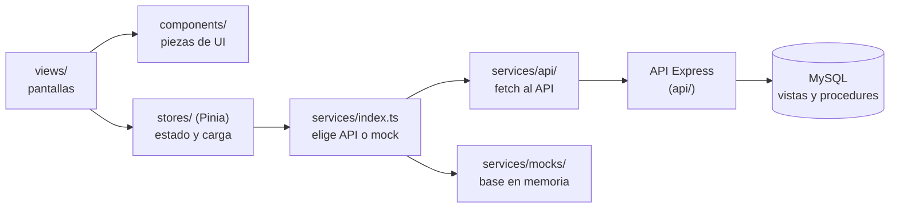

# Front de Carlitosco (`web/`)

Panel de administración de **Carlitosco Importaciones** (repuestos automotrices). Es la cara visible del proyecto final de Bases de Datos: **el centro del proyecto es la base** (`database/`: tablas, vistas, procedures y triggers), y este front existe para usarla. Cada pantalla lee una **vista SQL** o ejecuta un **stored procedure** a través del API; el front no calcula saldos, stock ni totales por su cuenta, los muestra tal como los devuelve la base.

> Mientras el API (`api/`) no esté listo, el front funciona completo con **mocks**: una base en memoria que reproduce las vistas y los procedures, con los mismos nombres de campo y los mismos mensajes. Cambiar al API real es cambiar una variable de entorno.

## Instalar y correr

Requisitos: **Node.js 22.18 o superior** (o 24.12+) y npm.

```bash
cd web
npm install
cp .env.example .env     # en Windows: copy .env.example .env
npm run dev              # http://localhost:5173
```

Con `VITE_USE_MOCKS=true` (el valor del ejemplo) se entra con estos usuarios de demostración:

| Usuario | Contraseña | Rol |
| --- | --- | --- |
| `admin` | `admin123` | Administrador (ve todo, incluida la administración de empleados) |
| `vendedor` | `vendedor123` | Vendedor |

Para usar el API real: levantar `api/` en el puerto 3000 y poner `VITE_USE_MOCKS=false`. En desarrollo, Vite manda todo lo que empieza con `/api` a `http://localhost:3000` (ver `vite.config.ts`), así que no hay problemas de CORS.

### Otros comandos

| Comando | Qué hace |
| --- | --- |
| `npm run build` | Revisa los tipos y genera la versión de producción en `dist/` |
| `npm run preview` | Sirve `dist/` para probar el build |
| `npm run test:unit` | Pruebas con Vitest (`npx vitest run` las corre una vez y termina) |
| `npm run type-check` | Solo la revisión de tipos (`vue-tsc`) |
| `npm run lint` | oxlint + ESLint, con arreglos automáticos |
| `npm run format` | Prettier sobre `src/` |

## Variables de entorno

Están en `.env` (copiado de `.env.example`). Todas las `VITE_*` terminan dentro del bundle que baja el navegador: **son públicas, nunca van secretos aquí**. Las credenciales de la base viven solo en el API.

| Variable | Ejemplo | Para qué |
| --- | --- | --- |
| `VITE_API_URL` | `/api` | Prefijo de todas las rutas del API |
| `VITE_USE_MOCKS` | `true` | `true`: los services usan los mocks en memoria. `false`: hablan con el API real |

`src/config/env.ts` es el único archivo que las lee, y la app no arranca si falta `VITE_API_URL`.

## Stack

| Pieza | Para qué |
| --- | --- |
| **Vue 3** (`<script setup>` + TypeScript) | Componentes y vistas |
| **Vue Router** | Rutas, guard de sesión y de rol |
| **Pinia** | Estado compartido (stores) |
| **Bootstrap 5.3** + Sass + Bootstrap Icons | Estilos, con los tokens del sistema de diseño (`design/DESIGN.md`) |
| **Chart.js** + vue-chartjs | Gráficos del dashboard |
| **jsPDF** + jspdf-autotable | Reportes en PDF, generados en el navegador |
| **Vite** | Servidor de desarrollo y build |
| **Vitest** + Vue Test Utils | Pruebas (324) |

## Arquitectura

Capas con una sola dirección de dependencia: la vista no sabe si los datos vienen del API o de los mocks.



| Carpeta | Responsabilidad |
| --- | --- |
| `views/` | Una por pantalla. Arman la página con componentes y llaman a los stores |
| `components/` | `common/` son genéricos (tabla, panel, diálogo, toasts) y no conocen stores ni rutas; el resto son de un módulo (`clientes/`, `pagos/`, …). Reciben props y avisan con eventos |
| `stores/` | Cargan, guardan en caché y exponen los datos. `ejecutarEscritura` centraliza las escrituras: toast con el mensaje del procedure y recarga de lo que cambió |
| `services/contratos/` | Interfaces de cada servicio: el "puerto" |
| `services/api/` | Implementación real: `fetch` a los endpoints (`http.ts` maneja sesión y errores) |
| `services/mocks/` | Implementación en memoria: replica `views.sql` y `procedures.sql` |
| `types/` | Tipos con los nombres **exactos** de las columnas SQL |
| `router/` | Rutas (`index.ts`) y menú (`navegacion.ts`) |
| `config/`, `utils/`, `composables/` | Variables de entorno y constantes; formato de moneda y fechas, validaciones, PDF; filtro de búsqueda en la URL |

Es el patrón **puertos y adaptadores**: `services/index.ts` es el único lugar que decide, con `VITE_USE_MOCKS`, qué adaptador usa cada servicio.

### Cómo viajan los errores de la base

Los procedures terminan con un mensaje `COMMIT: …` o `ROLLBACK: …`. El API lo traduce a HTTP y el front lo muestra:

| Respuesta | Origen | Qué ve el usuario |
| --- | --- | --- |
| `200 { mensaje }` | `COMMIT: …` | Toast verde con el mensaje del procedure ("cliente LUCÍA MORA registrado") |
| `422 { mensaje }` | `ROLLBACK: …` (regla de negocio) | Toast rojo con el texto tal cual ("el pago de 600.00 supera el saldo pendiente de 592.35") y el formulario sigue abierto |
| `401` | Sin sesión o sesión vencida | Vuelve al login |
| `500` / sin red | Error del servidor | Mensaje genérico, sin detalles de la base |

El front valida formato antes de enviar (largo de la cédula y el RUC, montos, emails), pero **la base tiene la última palabra**: las reglas de negocio están en los procedures, no en el front.

## Conexión con el API

Las rutas, los cuerpos y los códigos de respuesta completos están en [`docs/contrato-api.md`](../docs/contrato-api.md). En resumen:

| Endpoint | Fuente en la base | Pantalla |
| --- | --- | --- |
| `POST /api/auth/login` · `POST /api/auth/logout` · `GET /api/auth/me` | `tEmpleado` + `tRol` (contraseña con bcrypt) | Login, topbar |
| `GET /api/reportes/:vista` | Las 5 vistas de `views.sql` | Reportes y dashboard |
| `GET /api/catalogos/:nombre` | `tMarca`, `tCategoria`, `tBodega`, `tCiudad`, `tTipoIdentificacion`, `tFormaPago`, `tRol` | Los `<select>` de los formularios |
| `GET /api/clientes` · `POST /api/clientes` | `tCliente` · procedure `registrar_cliente` | Clientes |
| `GET /api/repuestos` · `POST /api/repuestos` | `tProducto` · procedure `ingresar_repuesto` | Repuestos |
| `POST /api/repuestos/traslados` | procedure `trasladar_repuesto` | Repuestos |
| `GET /api/pagos` · `POST /api/pagos` · `DELETE /api/pagos/:codigo` | `tPago` · procedures `registrar_pago` y `eliminar_pago` | Pagos |
| `POST /api/empleados` | procedure `contratar_empleado` | Administrar empleados |
| `POST /api/facturas` ⚠ | **Propuesta**: todavía no hay procedure | Nueva factura |

Después de cada escritura exitosa el front vuelve a pedir las vistas afectadas: como las vistas se calculan en la base, los reportes y el dashboard muestran el cambio sin lógica extra.

## Pantallas

| Ruta | Pantalla | Caso de uso | Qué hace con la base |
| --- | --- | --- | --- |
| `/login` | Iniciar sesión | CU-01, CU-02 | Login y logout; un empleado con `activo = 0` no entra |
| `/` | Dashboard | CU-03 | KPIs (saldo por cobrar, valor en bodegas, repuestos con stock) y 2 gráficos (venta por marca y categoría, valor por bodega), todos sobre las vistas |
| `/reportes/:vista` | Reportes | CU-04, CU-05 | Tabla con buscador de cada vista y exportación a PDF |
| `/clientes` | Clientes | CU-06 | Lista `tCliente`; alta y edición con `registrar_cliente` (INSERT o UPDATE) |
| `/repuestos` | Repuestos | CU-07, CU-08 | Catálogo con stock total y estado contra el `stock_minimo`; ingreso con `ingresar_repuesto` y traslado entre bodegas con `trasladar_repuesto` |
| `/facturas/nueva` | Nueva factura | CU-09 ⚠ | Cliente, líneas y total en vivo; el body es una propuesta (ver contrato) |
| `/pagos` | Pagos | CU-10, CU-11 | Registra con `registrar_pago`; elimina (DELETE, solo pagos de hoy) con `eliminar_pago` |
| `/administracion-empleados` | Administrar empleados | CU-12, CU-13 ⚠ | Solo administrador. Contrata o recontrata con `contratar_empleado`. Dar de baja = `activo = 0`, nunca un DELETE (pendiente de endpoint) |

Los formularios se abren en un **panel lateral** que flota sobre la página; borrar un pago siempre pasa por un diálogo de confirmación.

## Reportes: una pantalla por vista SQL

Los reportes son la parte que más directamente muestra la base. `src/types/reportes.ts` define cada uno **con los alias exactos de la vista**, así cada columna se rastrea hasta `database/views.sql`:

| Ruta | Vista SQL | Qué muestra | Columnas |
| --- | --- | --- | --- |
| `/reportes/repuestos-disponibles` | `repuestos_disponibles` | Stock de cada repuesto en cada bodega (solo `cantidad > 0`) | `Codigo_oe`, `descripcion`, `Marca`, `Bodega`, `ubicacion`, `cantidad` |
| `/reportes/cuentas-por-cobrar` | `Cuentas_por_cobrar` | Facturas emitidas con saldo pendiente (total con IVA − pagos − notas de crédito) | `seriefactura`, `Nombre_Cliente`, `fechafactura`, `Total`, `pagado`, `devolucion`, `Saldo` |
| `/reportes/empleados` | `Empleados` | Empleados y cuántas facturas emitió cada uno | `cedula`, `nombres`, `apellidos`, `Rol`, `activo`, `Facturas_emitidas` |
| `/reportes/bodegas` | `Bodegas_Disponibles` | Unidades, productos distintos y valor del inventario por bodega | `codigo_bodega`, `nombre`, `direccion`, `Productos_Bodega`, `Cantidad`, `Valor_Bodega` |
| `/reportes/desempeno-marca` | `Desempeno_marca` | Ventas con IVA por marca y categoría | `Nombre_Marca`, `Categoria`, `Venta_Marca` |

Todas usan la misma pantalla (`ReporteView`) y la misma tabla: agregar una vista nueva es agregar su definición en `types/reportes.ts`. El **PDF** (`utils/exportarPdf.ts`) lleva el logo, el título, la fecha, el usuario que lo generó y exactamente lo que se ve en pantalla, con el filtro aplicado.

## Mocks

`src/services/mocks/` es una base pequeña en memoria con datos de prueba (15 clientes, 24 repuestos, 5 bodegas, 25 facturas, 10 empleados):

- `vistas.ts` calcula las 5 vistas con la misma lógica que `views.sql`.
- `procedimientos.ts` reproduce los procedures: mismas validaciones, mismo orden y el **mismo texto** de los `COMMIT`/`ROLLBACK`.
- `simulador.ts` agrega una demora aleatoria, para que los estados de carga se vean como con un API real.

Los datos se reinician al recargar la página. Sirven de ejemplo ejecutable del contrato: si el API devuelve lo mismo que los mocks, el front funciona sin cambios.

## Componentes comunes

| Componente | Uso |
| --- | --- |
| `DataTable` | Tabla con buscador (sin tildes ni mayúsculas), skeleton de carga, estado vacío y filas clicables |
| `SidePanel` | Panel de formularios que flota a la derecha; Esc o la X lo cierran, un clic en el fondo no |
| `ConfirmDialog` | Confirmación antes de cualquier borrado |
| `FormField` | Label, ayuda y error accesibles para cada campo |
| `KpiCard`, `ChartCard` | Tarjetas del dashboard |
| `ToastHost` | Avisos de éxito, error e información |
| `EmptyState`, `ErrorDeCarga`, `AppIcon` | Estados vacíos, errores de carga con "Reintentar", íconos |

## Diseño

Colores, tipografía y componentes salen del sistema de diseño en [`design/DESIGN.md`](../design/DESIGN.md). `src/assets/styles/_tokens.scss`, `_components.scss` y `logo.png` son **copias exactas** de `design/system/`: se actualizan copiando el archivo, nunca editándolo aquí, y `.prettierignore` los protege. Los ajustes propios de la app van en `main.scss`.

## Pendiente (depende del API o de Carlitos)

- `POST /api/facturas`: las 4 decisiones de CU-09 (forma de pago, número de factura, IVA y stock) están en [`docs/planificacion.md`](../docs/planificacion.md).
- CU-13, dar de baja a un empleado: el botón está deshabilitado hasta que exista el endpoint.
- Confirmar los códigos que el front da por supuestos: roles `1` y `2` (`src/config/roles.ts`) y tipos de identificación `04`, `05` y `07`.
